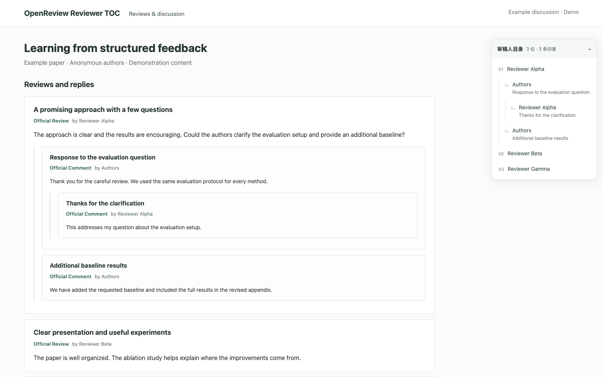

# OpenReview Reviewer TOC

A Chrome extension that adds a sidebar for reviewers and every reply in their discussion threads. Click an entry to expand and jump to it. Drag the header to move the sidebar; click it to collapse. Updates as replies load; no build needed.

*Actual extension UI on a demo discussion.*

## Install

1. Download [openreview-toc.zip](https://github.com/chansigit/openreview-toc/releases/latest/download/openreview-toc.zip) from the latest release and unzip it.
2. Open `chrome://extensions` and enable **Developer mode**.
3. Click **Load unpacked**, select the folder containing `manifest.json`, and refresh your OpenReview paper page.

Only reads the current page; no uploads or API requests. Lists loaded reviews and their replies. Load more replies on OpenReview if any are missing. [Privacy policy](PRIVACY.md).

## 中文

Chrome 插件，在 OpenReview 论文页显示审稿人及每条回复的嵌套目录。点击条目展开并跳转，拖动标题栏调整位置，点击标题栏折叠。随回复加载自动更新，无需构建。上图为演示讨论页上的实际截图。

1. 下载最新版 [openreview-toc.zip](https://github.com/chansigit/openreview-toc/releases/latest/download/openreview-toc.zip) 并解压。
2. 打开 `chrome://extensions`，开启「开发者模式」。
3. 点击「加载已解压的扩展程序」，选择包含 `manifest.json` 的文件夹，再刷新论文页。

仅在本地读取页面，不上传内容、不调用 API。目录只包含已加载的评审及回复；如有缺失，请先在 OpenReview 加载更多回复。
